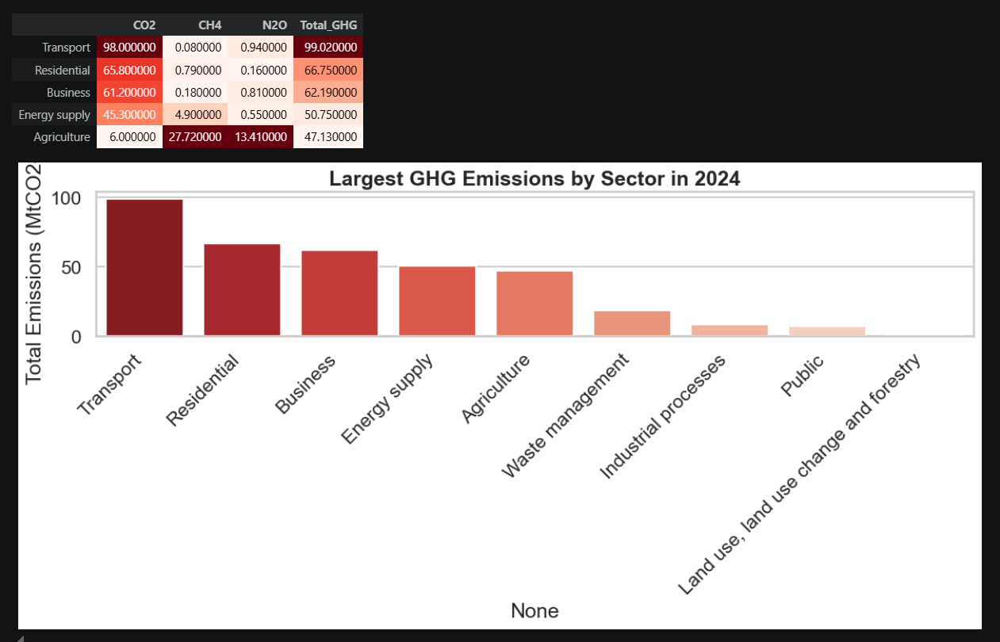
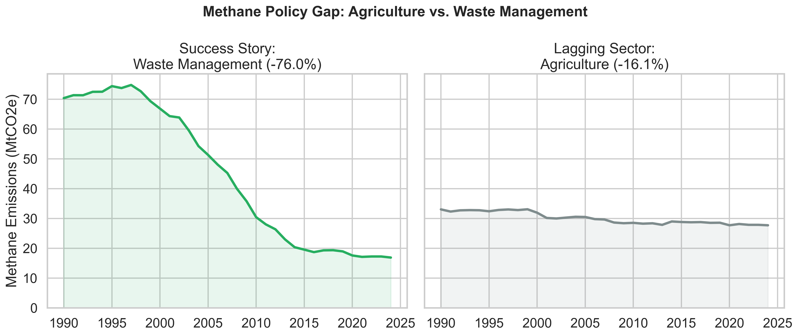
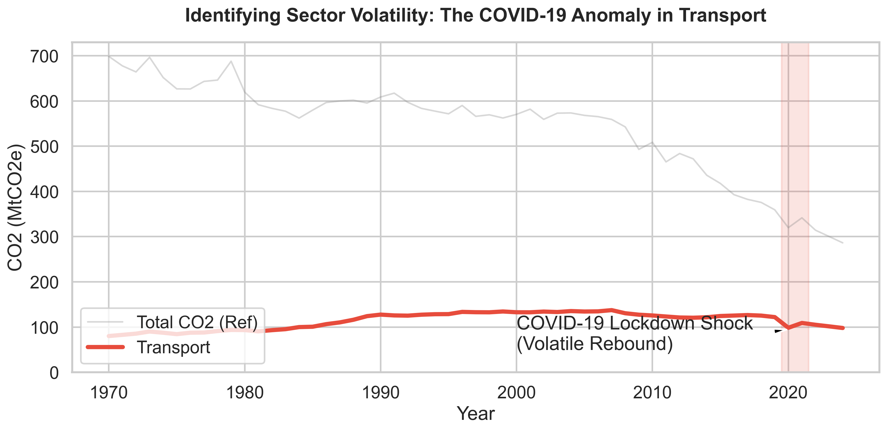

# UK Greenhouse Gas Emission Trends Analysis (1970-2023)

##  Project Overview
This repository contains a comprehensive Exploratory Data Analysis (EDA) of the UK's greenhouse gas emissions across three main categories (CO₂, CH₄, N₂O) from 1970 to 2023. Moving beyond basic historical trendlines, this project utilizes Python-driven techniques and predictive modeling to identify macro-deceleration rates, isolate structural anomalies, highlight multi-gas policy gaps, and forecast trajectories against the 2050 Net Zero mandate.

##  Key Objectives & Methodologies
*   **Sectoral Decomposition:** Identified the heaviest polluting sectors and their historical reduction/growth rates.
*   **Macro Emission Deceleration:** Calculated Rolling 5-Year Compound Annual Growth Rates (CAGR) to track the momentum of national decarbonization.
*   **Volatility Analysis:** Isolated the 2020 COVID-19 lockdown shock to prove the V-shaped rebound in the Transport sector.
*   **Lagging Indicators:** Contrasted Waste Management success with Agricultural Methane stagnation to highlight critical policy gaps.
*   **Predictive Forecasting:** Applied Machine Learning (`LinearRegression`) to mathematical test if current policies are sufficient to hit the legally mandated 2050 Net Zero target.

##  Technologies Used
*   **Language:** Python
*   **Data Manipulation:** Pandas, NumPy
*   **Data Visualization:** Matplotlib, Seaborn
*   **Machine Learning:** Scikit-Learn (Linear Regression)

##  Repository Structure
*   `analysis (1).ipynb` - The core Jupyter Notebook containing the full EDA, data cleaning, statistical analysis, and forecasting models.
*   `UK_GhG_by_Sector_2026.xlsx` - The raw dataset containing multi-sheet emissions data.
*   `UK Greenhouse Gas Emission Trends.pdf` - The final synthesized presentation poster of the core findings.
*   `*.png` - Various high-resolution output charts generated by the notebook (e.g., `net_zero_projection.png`, `correlation_heatmap.png`, `covid_shock_rebound.png`, etc.).

##  Key Insights
1.  **The Leader & The Laggard:** Energy Supply has driven the UK's success with the fastest historical reduction. However, Transport has failed to decarbonize structurally and is now the dominant emitter.
2.  **The Hidden Threat:** While CO₂ is dropping, Agricultural Methane has functionally flatlined for over 30 years, showing minimal policy effectiveness.
3.  **The Future Warning:** Our linear forecast confirms that the Transport sector will miss the 2050 Net Zero target significantly at its current trajectory, demanding aggressive new policy interventions.

##  Developer
**Muhammad Zeeshan Sadiq** 
*Python Developer & AI Engineer*